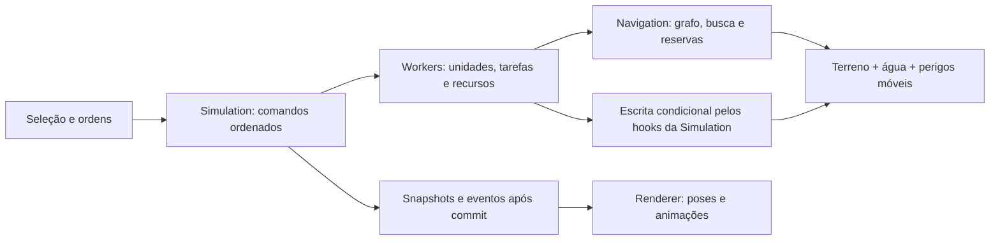

# Elovox — Navegação e unidades trabalhadoras

Data: 2026-10-07. Status: **base funcional implementada**, baseada em [pesquisa e experimento local](../research/2026-10-07-navigation-and-workers.md). Este documento preserva o design proposto, inclusive alternativas avançadas. O [relatório de implementação e validação](../reviews/2026-10-07-workers-validation.md) distingue o comportamento entregue das extensões futuras e registra os parâmetros efetivos.

## 1. Comportamento que queremos entregar

Unidades terrestres recebem ordens de deslocamento, escavação e construção. Andam na superfície e em cavernas, passam por degraus, respeitam volume e apoio, executam trabalho durante vários ticks e reagem a edições, água, blocos em queda e structural fragments. Várias unidades compartilham o mundo sem ocupar o mesmo espaço ou executar duas vezes a mesma tarefa.

A camada básica deve concluir obras acessíveis com recursos suficientes, ou apresentar uma causa precisa de bloqueio. O caminho de uma unidade é uma sequência de ações executáveis, com pré-condições; o desenho visual não determina a simulação.

Defaults sugeridos: corpo de 2 blocos de altura e menos de 1 bloco de largura; subir 1 bloco; queda voluntária máxima de 2; vadeamento até 0,5 bloco; sem natação, voo ou salto sobre vãos no primeiro incremento. Todos pertencem ao perfil de locomoção. Capacidade de escavar/construir não permite alterar qualquer bloco durante uma ordem de movimento: `allowRouteDig` e `allowRouteBuild` começam desabilitados.

Movimento terrestre, trabalho e materiais mínimos integram esta entrega. Combate, necessidades de colonos, veículos, navmesh de formas arbitrárias, cadeia econômica de depósitos e resistência material não são necessários para fechar essa capacidade. Múltiplos destinos e tarefas continuam possíveis sem um sistema geral de planejamento de toda a economia.

## 2. Módulos e autoridade

Dois módulos profundos concentram a complexidade:

- `NavigationSystem`: posições de apoio, transições, invalidação, scratch, busca, hierarquia e reservas. Interface interna pequena: solicitar/cancelar rota, notificar mudança, progredir com orçamento e obter resultado. Recebe leitores autoritativos do mundo; não escreve blocos.
- `WorkerSystem`: identidade/perfil, ordens, designações, atribuição, progresso, recursos, execução condicional, publicação e estado determinístico. Interface interna: comandos, fase anterior à física, fase posterior à física, invalidação em lote, publicação e `mixState`.

A seam entre eles é a solicitação de uma rota para uma posição ou conjunto de posições de trabalho. Detalhes de heap, portais e reservas ficam na implementação. Testes e chamadores atravessam a mesma interface. Interfaces públicas não expõem arrays mutáveis de entidades nem exigem conhecer a ordem interna dos sistemas.

O sim worker continua sendo o único escritor. Main thread apresenta e envia ordens; mesh workers não alteram unidades. Começar no mesmo worker evita consultas a snapshots parcialmente atualizados. Um worker adicional de navegação só entra mediante evidência: precisa de snapshot/versionamento explícito, aceite em tick determinístico e revalidação antes da execução. Ordem de chegada de mensagens não pode mudar o resultado de replay.

## 3. Grafo de apoio com vários andares

Um nó representa a posição dos pés `(x + 0,5, y, z + 0,5)` onde o corpo cabe e há apoio. Cada coluna pode ter vários nós: piso de caverna, superfície e ponte são distintos. Não usar apenas `columnTop` ou o chão superior da água.

Validação de um nó: coordenadas dentro do mundo; corpo sem sólido; apoio existente ou piso finito; água abaixo do limite do perfil; nenhuma interseção com perigo móvel; política de estabilidade satisfeita. Decoração visual e `opaque` não substituem `solid`.

Extrair posições em regiões 16³ alinhadas aos chunks 32³, inicialmente de forma preguiçosa perto de unidades/rotas. Comparar 8³, 16³ e 32³ no benchmark de manutenção. A região lê halo suficiente para corpo, apoio e transições; não pode perder um piso cuja cabeça está no chunk seguinte. Evitar materializar regiões de ar sem posições de apoio.

Usar posições/alturas, offsets de coluna, flags e arestas em arrays tipados. Referências persistentes de caminhos usam coordenadas e revisão da região; índices locais compactos só valem naquela geração do tile. Recompactar um tile não pode transformar silenciosamente um antigo node ID em outro lugar.

Cache compartilhado por **perfil de geometria/locomoção**, não por unidade. Inventário, ferramenta e fila de tarefas não exigem duplicar a geometria. Limitar quantidade de perfis, cache e scratch. Contextos de busca são reciclados em pool; não alocar arrays do mundo inteiro por trabalhador. Memória limitada não autoriza evictar uma página usada por busca ativa sem cancelá-la explicitamente.

## 4. Transições físicas e custos

Primeiro implementar quatro direções, subida de um bloco e descida limitada. Depois acrescentar diagonais no mesmo nível, verificando os dois corredores laterais e o volume varrido. Nenhuma diagonal pode atravessar o canto de duas paredes. Subir exige espaço sobre a origem e sobre o destino; descer exige corredor vertical livre até o apoio.

Cada transição guarda modo, origem/destino, custo inteiro em ticks/unidades fixas, volume varrido e dependências. Sólido, capacidade de apoio e volume são verificados ao planejar e novamente ao iniciar/continuar o movimento. Limitar dimensões dos perfis para que essa validação tenha custo previsível.

Usar Q8 para posição, velocidade e duração, compatível com gravidade existente. Integração e colisão usam inteiros; renderização interpola para floats. Movimento precisa atravessar todos os voxels cruzados, mesmo se velocidade ou tickHz forem alterados. Units não são apoios de blocos/fragmentos; a física de terreno mantém sua autoridade.

Custos: deslocamento + subida/queda + duração de escavação + colocação + transporte quando existir + penalidades não negativas. Usar duração de material/ferramenta, não uma constante que incentive abrir túneis em toda ordem. Água e perigo podem proibir uma transição; penalidades sozinhas não tornam uma ação fisicamente possível.

Heurística inicial: distância horizontal × menor custo permitido por avanço. Não somar altura usando Manhattan 3D sem provar que subida/descida compostas não a tornam excessiva. Uma heurística melhor pode combinar limites inferiores com `max`, desde que permaneça admissível/consistente. Campos de distância para múltiplos destinos usam Dijkstra reverso sobre as arestas dirigidas.

## 5. Busca retomável e escala

A* com heap binário e desempate estável `(f, h, coordenada/ID)`. Scratch tipado paginado, stamps, pais e custos; evitar objetos por expansão e `Array.shift()` em filas quentes. Ordem fixa de vizinhos e critérios de atribuição reproduzíveis.

Estados distintos: `pending`, `found`, `unreachable`, `cancelled`, `limited`, `stale`. Esgotar orçamento, horizonte, memória, raio de obras ou limite de nós produz `pending`/`limited`, nunca uma prova de ausência de rota. Um grafo ainda incompleto ou sujo também não prova `unreachable`.

Orçamentos contam todas as fases: extração, leituras, vizinhos/arestas, retiradas obsoletas do heap, reconstrução, validação, atualização de portais e publicação. Resultado pode ser reconstruído em várias fatias antes de ficar disponível. Limites são por quantidade de trabalho; relógio serve apenas para medir. Não usar o fallback `Infinity` de `JobRunner` nem drenar uma grande busca dentro de `finish()`.

Fila com prioridades, idade e round robin; o primeiro destino longo não pode bloquear todas as unidades. Limitar consultas ativas e coalescer pedidos substituídos. Mudança irrelevante não reinicia a busca. Mudança necessária cancela/revalida; reinícios repetidos causam backoff em ticks e diagnóstico, sem retirar o teto de trabalho.

Depois de validar a base, montar hierarquia inspirada em HPA*. Nós abstratos são **portais e ligações entre componentes locais**, não um único nó por chunk. Uma caverna e um teto no mesmo chunk não são conectados por isso. Quedas tornam o grafo dirigido: componentes fracos permitem rejeição de regiões separadas, mas não provam alcance nos dois sentidos. Consultas positivas percorrem arestas dirigidas reais.

Manter travessias intrarregião sob demanda por entrada/perfil/revisão; evitar pré-calcular todos os pares de portais sem orçamento. Preservar entradas por camada e classe de transição. Se amostragem/limite de portais puder omitir uma conexão, usar fallback ou `limited`; não produzir falso `unreachable`. Uma rota HPA* pode ser subótima: qualidade e conectividade precisam ser medidas no nosso grafo.

Refinar alguns segmentos à frente. Se não houver segmento completo validado e reservado, a unidade espera em pose segura. Não caminhar arbitrariamente até o melhor nó de uma busca parcial sem considerar saída, apoio e reserva. Hierarquia de locomoção não rejeita uma conexão que uma obra autorizada pode criar: separar ausência de passagem atual de impossibilidade de engenharia.

## 6. Invalidação por dependência

Manter revisões separadas:

- `geometryRevision`: sólido, apoio, volume e tipo de transição.
- `hazardRevision`: água cruzando faixas relevantes e ocupação móvel; profundidade exata continua revalidada localmente.
- `workRevision`: escavabilidade, material, ferramenta necessária, proteção e destino de obra.
- Revisão de política/perfil e reservas temporais.

Uma mudança de luz não invalida navegação. Trocar dois sólidos equivalentes pode preservar locomoção e invalidar custo/trabalho. Água ar ↔ líquido no espelho não precisa reconstruir todo o grafo geométrico; alteração do limite de vadeamento deve invalidar a passagem afetada.

`applySet` notifica classificação antiga/nova e regiões com halo. Cobrir também `applyColumn`/geração inicial, `replaceColumns`, escritas quietas de água e detach/landing. Não derivar geometria de `dirtyChunks`: eles incluem luz/vizinhos de mesh e podem omitir atualizações quietas importantes para perigo.

Caminhos rastreiam as regiões lidas para corpo, apoio, teto, corredor e portais, não apenas coordenadas dos pés. Checar só o bloco do destino perde um teto novo ou apoio removido. Atualizações de fronteira invalidam ambos os tiles envolvidos. Publicar tile reconstruído somente contra revisões ainda válidas; manter a versão anterior suja/inutilizável para novas provas.

Ordens bloqueadas se inscrevem nas mudanças relevantes de acesso, perigo ou estoque. Abertura de um túnel acorda ordens dependentes; não testar todos os alvos a cada tick. Mudança distante do caminho não interrompe um trabalhador que continua com todas as pré-condições válidas.

## 7. Água, quedas e estabilidade

Criar uma consulta pequena ao WaterSystem para profundidade/perigo na altura dos pés. Ela consulta o segmento superior ou `UnderSegments`, após a física de água; não copia a estrutura hidráulica para cada unidade. Histerese ajuda a evitar reinícios constantes perto do limiar, mas a checagem final nunca permite profundidade maior que o limite seguro do perfil.

Ar estático pode conter um FallingBody ou Structural fragment fora da grade. Acrescentar consultas por coluna/AABB varrida a GravitySystem e CollapseSystem, reutilizando os índices existentes. Validar a ocupação durante o tick, não apenas a pose final: um fragmento rápido pode atravessar a unidade entre snapshots.

O solver atual não publica um certificado de estabilidade por posição. Primeira política conservadora: normal fixed supports seguem disponíveis; apoio em collapsible blocks só é admitido quando as verificações de topologia estiverem concluídas. Enquanto houver alterações estruturais não resolvidas, suspender novas entradas em apoio estrutural potencialmente afetado. Inicialmente pode ser uma barreira global para apoios estruturais; otimização por componente exige um índice correto de dependências.

Não assumir que apenas o chunk do suporte removido ficou instável: uma viga longa pode conectar regiões distantes. Uma unidade já sobre apoio pendente suspende trabalho e checa apoio/queda; não é teleportada. Política inicial de escavação evita remoção automática de apoio de estruturas ocupadas; pedidos explícitos perigosos precisam de política configurada e resultado observável. Isso não é uma previsão completa de estabilidade de toda obra futura.

Se o apoio desaparece, transitar para `falling`, interromper trabalho, liberar reservas futuras e integrar gravidade/colisão. Se atingida por geometria física móvel, aplicar política explícita de incapacitação/remoção e liberar tarefa/recursos. A unidade não impede o solver de colapso de agir. Essas políticas pertencem ao jogo; os defaults da sandbox devem ser descritos e testados.

## 8. Tarefas, posições de trabalho e materiais

Separar tarefa de usuário de tarefa computacional `RegionJob`. Usar `WorkOrder` para desejo do jogador, `WorkTask` para a operação num bloco e designação compacta para uma área. Grandes áreas são expandidas progressivamente com bitsets/tiles; não criar um milhão de objetos/tarefas/rotas em um comando.

Uma tarefa possui tipo/alvo, bloco esperado, prioridade, dependências, progresso, política de materiais, estado e claim. A unidade se desloca a uma **posição de trabalho** de onde alcança a face do alvo, com linha de visão curta e corpo livre. Procurar vários destinos válidos numa consulta multigoal; não escolher apenas o vizinho geometricamente mais próximo. Nunca usar o voxel sólido do alvo como destino dos pés.

Estados de tarefa: pendente, atribuída, deslocamento, trabalho, concluída, bloqueada e cancelada. Bloqueios distinguem `no-access`, `missing-material`, `missing-tool`, `unsafe`, `traffic`, `search-limited` e `target-changed`. Claim é exclusivo por tarefa/alvo e tem lease em ticks; cancelamento, incapacidade e perda de acesso liberam-no.

Atribuição: índice espacial de ordens e unidades ociosas, capacidade/ferramenta/estoque, shortlist pequena e estimativa de custo; confirmar alcance por navegação. Não fazer N unidades × M blocos com uma busca para cada par. Idade aumenta prioridade para evitar starvation. Várias unidades recebem posições/destinos distintos quando vão para uma mesma área.

Escavação em área usa fronteira acessível e preserva uma pose segura. Limpar corpo antes de avançar; retirar apoio que a própria unidade usa demanda outra pose ou tarefa específica. Escavação de túnel progride a partir da abertura. Se não há face alcançável, bloqueio informa falta de acesso, sem remoção remota.

Construção usa blueprint de blocos-alvo e dependências físicas/de acesso. Apoios antes de blocos dependentes; não fechar acesso ao último bloco nem ocupar o corpo de outra unidade. Andaime/escada temporários têm materiais, tarefas de montagem e retirada e uma política de uso. Não assumir que ordenar apenas por Y resolve toda obra; pontes e espaços fechados exigem acesso planejado.

Metadados de trabalho, fornecidos pelo aplicativo: `digTicks`, ferramenta necessária, permissão de escavação, drops, `buildTicks` e material consumido. Ausência da definição não implica que o bloco normal seja indestrutível; implica que a unidade não possui uma operação autorizada para esse tipo. Tabela derivada por ID evita consultas a objetos no loop quente.

Estoque mínimo real: blocos por tipo, capacidade e reservas. Retirar um bloco pode fornecer material uma única vez; se não cabe, sobra vira um drop/estoque persistente, sem perda silenciosa. Colocar consome somente após commit bem-sucedido. Caso criativo com materiais ilimitados é uma configuração explícita da demo, não uma suposição da engine. Reabastecimento inicial pode ser um comando de stock; transportar de depósitos é uma extensão com tarefas próprias.

## 9. Rotas que modificam o terreno

Deslocamento comum usa apenas o grafo existente. Com política de engenharia habilitada, um planejador local pode propor `dig → walk`, `placeSupport → walk` ou construir degraus acessíveis. Limitar raio, quantidade de edits e materiais para manter o custo previsível. Para obras longas, expandir tarefas/frontiers explícitos ou candidatos de conexão entre regiões; não pesquisar todas as combinações de mundos possíveis.

Estado do planejador inclui posição, recursos relevantes e overlay de alterações locais. Dois estados com estoque/apoios diferentes não são equivalentes. Dominar um estado exige custo não maior e recursos/possibilidades pelo menos equivalentes sob o mesmo overlay e política. Uma implementação inicial pode manter rótulos separados, usando poda simples e limites declarados.

O plano não publica blocos futuros no mundo. Cada edit tem pré-condições e uma posição de trabalho segura. Executar prefixo curto, reconstruir navegação e replanejar após a alteração física. Um floor colocado pode cair ou inundar uma passagem; não usar o apoio até validar o estado real resultante. Recursos de ferramentas, várias espécies de materiais e estrutura aumentam o espaço de estados; a primeira versão restringe as ações suportadas e reporta `limited` quando ultrapassa esse modelo.

Esse planejador não promete achar toda rota que algum conjunto arbitrário de construções tornaria possível. A capacidade completa deste milestone significa concluir operações suportadas ou explicar bloqueios, respeitando orçamento e física; não resolver otimamente qualquer problema combinatório de engenharia.

## 10. Execução condicional e transações

Trabalho progride em ticks apenas enquanto alcance, pose, alvo, claim e segurança são válidos. Na conclusão, fazer compare-and-set lógico no sim worker: conferir ID/state esperado, corpo/ocupação, bloco substituível, ferramenta e estoque reservado; escrever pelos hooks existentes. Não executar `setVoxelQuiet` nem chamar diretamente o store para uma obra.

Mudança do alvo por outra unidade/jogador invalida a ação. Alvo já escavado pode satisfazer a tarefa sem outro drop; alvo já construído no material desejado pode satisfazê-la sem outro consumo. Alvo incompatível gera replanejamento/bloqueio. IDs/gerações evitam que uma resposta antiga afete uma ordem nova.

Reservar slots necessários antes de commits que envolvam recursos ou múltiplas células. A operação por bloco deve ser atômica quanto a material/drops/claim. `RuleContext.set` é um bom modelo de hook, mas não fornece confirmação transacional suficiente: acrescentar seam interna de escrita condicional com resultado, validação antecipada e regra explícita para falhas de callbacks. Falhas após uma escrita nunca podem duplicar drops ao tentar novamente.

Toda grande obra consiste em commits pequenos, progressivos e observáveis. Cancelar interrompe ações futuras e devolve reservas; não desfaz blocos já escritos ou recupera material já gasto automaticamente. Undo de mundo é uma operação diferente e deve passar pela simulação.

Comandos de jogador/fill/construção não podem colocar sólidos dentro de unidades ativas. Fazer preflight usando índice de ocupação. Remover seu apoio continua permitido, com transição de queda. Regeneração intersectando corpo ocupado deve ser rejeitada antes da escrita, ou usar um comando explícito de reset das unidades; não embutir relocação silenciosa em `columnTop`.

## 11. Coordenação entre unidades

Separar reservas de tarefa, materiais e trânsito. Índice espacial acompanha volume atual; tabela temporal reserva corpo/corredor/apoio e travessia para os próximos ticks. Reservar a aresta inversa impede duas unidades trocarem de lugar através uma da outra. Durações distintas e unidades maiores reservam intervalos e footprints completos.

Trabalhador escavando/construindo fica parado e mantém a pose de trabalho ocupada por toda a duração. Fim de horizonte não torna seu corpo disponível. Reserva de destino de outra unidade também não pode expirar enquanto ela permanece ali.

Primeiro usar movimento arbitrado por prioridade/idade, espera e escolha de pose de recuo. Introduzir busca cooperativa em janela para corredores com contenção. Janela inicial proposta: 32 ticks; revisar nos testes de trânsito. Guardar reservas só para células/intervalos usados, com geração do tick para reciclagem.

Unidades detectam falta de progresso e tentam espera, ceder passagem/recuar, escolher outra posição de trabalho ou replanejar. Recuo requer espaço físico e rota reservada. Corrigir livelock por envelhecimento e reordenação determinística. Corredor sem qualquer espaço para passagem pode ser insolúvel: retornar `traffic`, não alternar indefinidamente nem prometer completude global do planejamento priorizado.

## 12. Integração no tick e no protocolo

Sequência proposta, preservando a ordem relativa das fases físicas existentes:

1. Validar/aplicar comandos ordenados. `WorkerSystem.beforePhysics` conclui intenções de trabalho do tick anterior, condicionadas ao mundo atual.
2. Processar notificações/regras agendadas com o teto existente.
3. Executar gravidade, água, region jobs e colapso como hoje.
4. Processar random ticks/notificações como hoje.
5. `WorkerSystem.afterPhysics`: observar perigo/apoio, atualizar invalidação, progredir reconstruções/buscas/atribuição, arbitrar movimento e produzir próximas intenções. Novas ordens passam a agir sob a física observada; mudanças posteriores invalidam a próxima intenção.
6. Propagar luz, flush de água e commit dos seqlocks. Publicar poses/eventos juntamente com tick e versões de terreno necessárias ao renderer.

Na pausa: comandos de ordem/cancelamento podem entrar; unidades não andam nem progridem trabalho, leases e tempo de reservas avançam pelo relógio de física, não pelo número de ticks que ainda processam edição/luz. Edits/regeneração invalidam caches; retomar começa com revalidação. O `physics.busy` inclui trabalho ativo, movimento, buscas pendentes e invalidação, sem considerar como busy eterno uma ordem bloqueada que só aguarda um evento externo.

Novos comandos tipados: spawn/despawn, move/order/cancel, dig/build designation, stock e prioridade. Validar dados finitos/inteiros, perfil/material existente, posição, limites de unidade/designação e autorização da política. `Ack.ok` significa ordem aceita, não obra concluída. Eventos separados comunicam conclusão/bloqueio, ligados ao order ID e à sua geração.

IDs monotônicos; loops com ordem estável; posições/custos/progresso inteiros. `Simulation.hash()` incorpora estado futuro relevante: unidades, ordens, claims, estoque, reservas, intenções, busca e desempates. Caches derivados podem ser reconstruídos, mas o protocolo de reconstrução não pode mudar o comportamento de replay. Replays incluem todas as novas ordens e config/perfis. A engine ainda não possui um formato geral de save de unidades: snapshot/restauração exigem versão explícita se adicionados.

## 13. Publicação, personagem e experiência na sandbox

Publicar nascimento/morte/perfil uma vez e poses/estados em buffer compacto; não copiar todas as árvores de tarefas/caminhos por tick. Uma pose Q8 com ID, XYZ, orientação e estado pode ficar em ~24 bytes: 1.000 unidades a 20 Hz dariam ~480 kB/s de payload bruto se todas forem publicadas; é cálculo, não throughput medido. Acrescentar bytes/tempo de serialização às métricas. Transfer buffers e deltas antes de acrescentar novo shared protocol.

Main thread interpola snapshots, anima `idle`/`walk` e estados visuais de trabalho. Substituir um RAF por personagem por uma atualização central no render loop. Se o GLB não possui `dig`/`build`, fallback visual explícito; conclusão real continua no worker. Para muitas unidades, instancing/proxies e LOD; reservar modelos esqueléticos para unidades próximas e não prometer 1.000 mixers baratos.

Usar as barreiras de versões de mesh existentes para commits de escavação/construção. A pose apresentada pode aguardar o terreno visual necessário ficar pronto, enquanto a autoridade sim continua determinística. Não fazer a simulação depender de quando o GPU terminou um mesh. Evitar que a unidade visual atravesse uma parede antiga ou fique sobre apoio ainda invisível.

Sandbox `?scene=workers`: seleção por clique/retângulo, deslocamento contextual, ferramentas distintas de designação para escavar/construir, material escolhido, preview do blueprint, cancelamento e prioridade. Destinos inválidos e trabalho bloqueado apresentam motivo e progresso. A ferramenta atual de edição direta de blocos continua disponível em seu modo; não substituir cliques existentes sem contexto de seleção/modo.

Overlay de debug sob demanda: nós/portais locais, rota atual, volumes, posição de trabalho, reservas, revisões e razão de replanejamento. Evitar desenhar o grafo do mundo inteiro. HUD mostra unidades ativas, tarefas, buscas, nós/arestas processados, reinícios, memória, bytes e tempos por fase.

## 14. Critérios de conclusão

Concluir locomoção, ordens de trabalho acessíveis e cooperação, com cenários reproduzíveis e teste de regressão dos sistemas existentes. Validar tetos/quinas, andares distintos, trânsito em sentidos opostos, apoio removido, água em caverna, material insuficiente, alvo alterado, claim exclusivo, cancelamento e pausa.

Matriz de escala: 1/100/1.000 unidades; mundos 256² e 1024² × 128; ociosas, andando, trabalhando e gargalo; terreno estável, água ativa e colapso. Separar CPU sim, manutenção do grafo, latência da primeira ação, payload, memória e custo visual. Medir p50/p95/p99/max e tempo de aquecimento; não esconder falhas sob uma média.

Meta inicial para validação: sim tick p95 ≤ 10 ms no hardware registrado e custo incremental de navegação/unidades próximo de ≤ 2 ms em carga cotidiana; ajustar a admissão/configuração a partir dos testes integrados. Meta de primeira ação para ordens curtas aquecidas: p95 ≤ 250 ms com 100 unidades. Para 1.000 e explosões de ordens, reportar latência e estabelecer limite após a medição. Estes são alvos de aceitação propostos, não resultados obtidos.

Se escala exigir otimização, escolher a fase medida: hierarquia/heurística para expansão, invalidadores para replan storm, contextos paginados para memória, candidatos para atribuição e LOD para renderização. Manter um caminho de referência exato em mapas pequenos para verificar custo e alcance de cada otimização.
